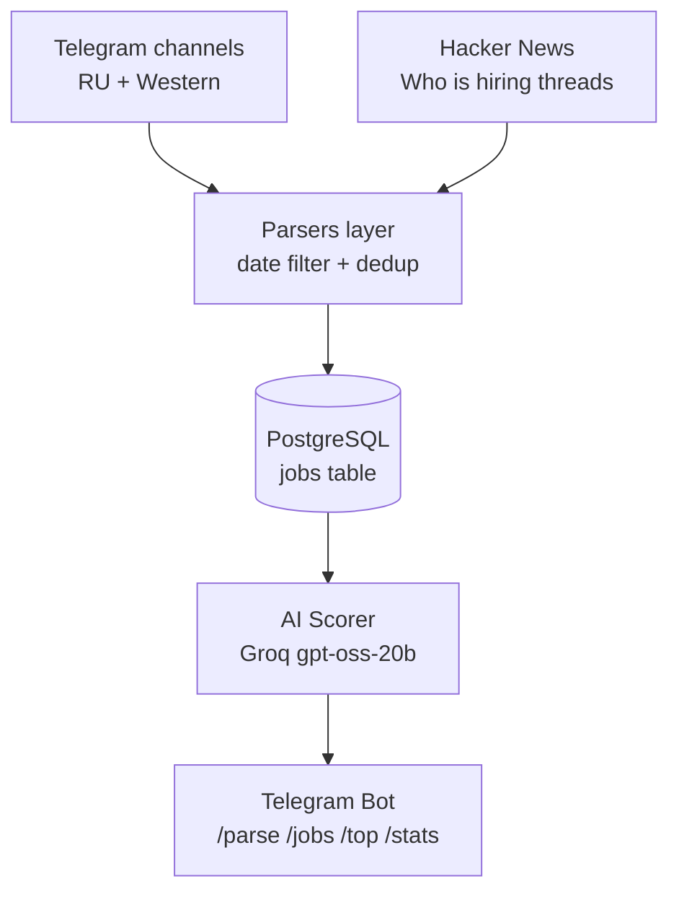

# Job Aggregator

> AI-powered job aggregator that scrapes Telegram channels and Hacker News, scores each posting against a developer profile using an LLM, and delivers top matches to a Telegram bot.


## The Problem

Finding a junior developer job or freelance gig is a full-time job itself. Hundreds of postings across dozens of channels, and 95% of them are either senior roles, wrong stack, or plain spam. Manual filtering takes hours per day.

**Job Aggregator solves this**: it collects postings from multiple sources, uses an LLM to score each one against a specific developer profile, and sends only the relevant matches to Telegram.

## Features

- **Multi-source parsing** — Telegram channels (RU + Western) and Hacker News "Who is hiring?" threads
- **Split modes** — `western`, `ru`, `all` (with manual trigger via bot)
- **AI scoring (0-100)** — every posting is evaluated by `gpt-oss-20b` with a strict prompt
- **Hard caps for senior roles** — roles with `Senior`/`Staff`/`Lead`/`Founding`/`Manager` in the title automatically get max 25 points, regardless of stack match
- **Auto-filtering** — postings older than 30 days are skipped, duplicates are de-duplicated by `raw_hash`
- **Telegram bot** — manual parse trigger with confirmation flow, job browsing, top-10, statistics
- **Full Docker** — `docker-compose up` and you're running

## Tech Stack

| Layer | Technology |
|---|---|
| Language | Python 3.11 |
| Web framework | FastAPI |
| ORM | SQLAlchemy (async) |
| Database | PostgreSQL 16 |
| Cache / queue | Redis 7 |
| Migrations | Alembic |
| Telegram bot | aiogram 3.x |
| Scraping | tgscraper, httpx, BeautifulSoup |
| LLM | Groq API — `openai/gpt-oss-20b` |
| Scheduler | APScheduler (manual mode) |
| Container | Docker + docker-compose |

## Architecture



## AI Scoring

The scorer uses a strict prompt with **hard caps** so senior roles never pollute the feed:

| Condition | Max score |
|---|---|
| Title has `Senior`, `Staff`, `Lead`, `Head`, `Founding`, `Manager`, `Architect`, `Experienced` | **25** |
| Description requires 3+ years of experience | **25** |
| Stack doesn't match `React` / `TypeScript` / `Python` / `FastAPI` | **10** |
| Posting is not a job (article, ad, digest) | **5** |
| Title is vague | **5** |
| Explicitly `junior` / `entry` / `intern` + stack match | **min 60** |

Each score comes with 1-2 sentence reasoning stored in `ai_reason`.

## Quick Start

### Prerequisites

- Docker + Docker Compose
- Groq API key ([console.groq.com/keys](https://console.groq.com/keys))
- Telegram bot token ([@BotFather](https://t.me/BotFather))

### 1. Clone

```bash
git clone https://github.com/UnNoir228/job-aggregator.git
cd job-aggregator

```

### 2. Configure

```bash
cp backend/.env.example backend/.env
```

Fill in `backend/.env` with your keys:

- `GROQ_API_KEY` — get free at [console.groq.com/keys](https://console.groq.com/keys)
- `TELEGRAM_BOT_TOKEN` — from [@BotFather](https://t.me/BotFather)
- `TELEGRAM_OWNER_CHAT_ID` — your Telegram user id
- `TELEGRAM_API_ID` / `TELEGRAM_API_HASH` — from [my.telegram.org](https://my.telegram.org)

### 3. Run

```bash
docker-compose up -d
```

API: `http://localhost:8000`. Swagger docs: `http://localhost:8000/docs`.

### 4. Use the bot

Open your bot in Telegram and send:

- `/start` — main menu
- `/parse` — run parsing (Western sources first, then asks about RU with inline buttons)
- `/jobs` — latest 5 postings with score >= 60
- `/top` — top-10 from the past week
- `/stats` — database statistics

## Development

Hot-reload is enabled via `docker-compose.override.yml`. Code changes in `backend/` are picked up automatically without rebuild.

After changing `.env`:

```bash
docker-compose restart backend
```

To manually re-score all postings:

```bash
docker-compose exec backend python rescore.py
```

## Roadmap

- [x] Telegram channels parser (RU + Western)
- [x] Hacker News parser
- [x] AI scoring with hard caps for senior roles
- [x] Telegram bot with manual parse trigger
- [ ] Reddit parser (r/forhire, r/hireforgigs)
- [ ] Twitter parser
- [ ] Web dashboard (Next.js)
- [ ] Deploy 24/7 on VPS

## License

MIT

## Author

**UnNoir228** — [GitHub](https://github.com/UnNoir228)

